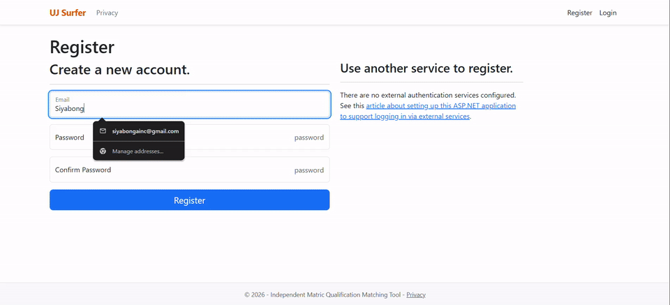

# UJ Surfer 🏄‍♂️🎓

> **Independent Matric Qualification & APS Eligibility Explorer for the University of Johannesburg**

[](https://dotnet.microsoft.com/)
[](https://learn.microsoft.com/aspnet/core)
[](https://learn.microsoft.com/ef/core/)
[](https://getbootstrap.com/)
[-success)](#-privacy--legal-disclaimer)

---

## 📽️ Preview



---

## 📖 Overview

**UJ Surfer** is an academic planning application created to help South African matriculants, educators, and prospective tertiary applicants seamlessly navigate university admission prerequisites.

Instead of manually leafing through the 100-page University of Johannesburg prospectus, users input their seven National Senior Certificate (NSC) subjects and marks once. The system automatically computes their Admission Point Score (APS) according to official South African grading conversions and cross-checks their profile against **179+ qualifications across all 8 faculties and college divisions**.

---

## ✨ Key Features

- **Automated APS Engine:**
  - Converts percentage marks (0–100%) to official NSC Achievement Levels (1–7).
  - Automatically identifies the best 6 school subjects while strictly **excluding Life Orientation (LO)** in accordance with UJ admission rules.
- **Unified 7-Subject Matric Entry:**
  - Two official languages (Language of Learning/Teaching like English + Second Language).
  - Mathematics choice gatekeeper (Pure Mathematics, Mathematical Literacy, or Technical Mathematics).
  - Three open electives (Physical Sciences, Life Sciences, Accounting, Geography, Business Studies, Economics, IT, CAT, etc.).
- **Smart Prerequisite Matching:**
  - Checks minimum base APS thresholds.
  - Enforces specific subject constraints (e.g., pure Maths $\ge$ 70% for BSc IT/CS; Mathematics Level 4 for BCom; selective math literacy acceptance).
  - Intelligently recognizes optional/not applicable science requirements without dropping eligible degrees.
- **Account Persistence & Session Security:**
  - Powered by **ASP.NET Core Identity** (`ApplicationUser`).
  - **Single-entry persistence:** Users save marks once; their qualified degrees/diplomas are retrieved automatically on future visits without re-entry.
  - **5-Minute Inactivity Session Timeout:** Automatically counts down in the navigation bar and signs out idle sessions for student data protection.
  - **Relaxed browser-password policy:** Seamlessly registers passwords suggested by Google Chrome / Apple Keychain without arbitrary character rejection.
- **Instant Client-Side Filtering:**
  - Real-time search across programme names, faculty acronyms (`FADA`, `CBE`, `FEBE`, `LAW`, `SCI`, etc.), campuses (`APK`, `DFC`, `APB`, `SWC`), and career prospects.

---

## 🏛️ Faculties Covered

All data is pre-seeded from the official **2027 UJ Undergraduate Prospectus**:

| Acronym | Faculty / Division | Programmes | Delivery Campuses |
| :--- | :--- | :---: | :--- |
| **FADA** | Faculty of Art, Design and Architecture | 10 | APB |
| **CBE** | College of Business and Economics | 36 | APK, APB, SWC, Online |
| **EDU** | Faculty of Education | 14 | APK, SWC |
| **FEBE** | Faculty of Engineering and the Built Environment | 25 | APK, DFC |
| **HEALTH** | Faculty of Health Sciences | 16 | DFC |
| **HUM** | Faculty of Humanities | 11 | APK, APB, SWC |
| **LAW** | Faculty of Law | 3 | APK |
| **SCI** | Faculty of Science | 64 | APK, DFC |

---

## 🛠️ Architecture & Tech Stack

- **Backend:** C# (.NET 10 LTS), ASP.NET Core MVC
- **Authentication & Authorization:** ASP.NET Core Identity with custom `ApplicationUser`
- **ORM / Database:** Entity Framework Core (Code-First) & Microsoft SQL Server
- **Frontend:** Razor Views, Bootstrap 5.3, Vanilla JavaScript
- **Data Ingestion:** Automated JSON seeder (`DbInitializer.cs`) parsing structured prospectus files into relational schema tables:
  - `Faculties`
  - `Contacts`
  - `Programmes`
  - `SubjectRequirements`
  - `StudentMatricProfiles`

---

## 🚀 Getting Started

### Prerequisites

- [.NET 10 SDK (LTS)](https://dotnet.microsoft.com/download)
- [Visual Studio 2022 / 2026+](https://visualstudio.microsoft.com/) or [VS Code](https://code.visualstudio.com/) with C# Dev Kit
- [SQL Server](https://www.microsoft.com/sql-server/) (LocalDB, Express, or Developer Edition)

### Installation

1. **Clone the repository:**
   ```bash
   git clone https://github.com/Siyabonga-APIs/UJ_SurferMVC.git
   cd UJ_SurferMVC/UJ_Surfer
   ```

2. **Configure your Database Connection:**
   In `appsettings.json`, confirm your `DefaultConnection` string:
   ```json
   "ConnectionStrings": {
     "DefaultConnection": "Server=(localdb)\\mssqllocaldb;Database=UJSurferDB;Trusted_Connection=True;MultipleActiveResultSets=true"
   }
   ```

3. **Apply Migrations and Seed Database:**
   Using the .NET CLI:
   ```bash
   dotnet ef database update
   ```
   *Or in Visual Studio Package Manager Console:*
   ```powershell
   Update-Database
   ```

4. **Run the Project:**
   ```bash
   dotnet run
   ```
   Open your browser and navigate to `https://localhost:7000` (or the port indicated in terminal). 
   *Note: On first boot, `DbInitializer` will parse the JSON files in `Data/JSON/` and populate all faculty qualifications automatically.*

---

## 🔒 Privacy & Legal Disclaimer

- **POPIA Notice:** In compliance with the South African *Protection of Personal Information Act 4 of 2013 (POPIA)*, user email credentials and self-reported matriculation marks are encrypted and used solely for session authentication and criteria checking.
- **Institutional Non-Affiliation:** **UJ Surfer is an independent educational tool** and is not affiliated with, endorsed by, or sponsored by the **University of Johannesburg (UJ)**. All names, logos, qualification codes, and minimum criteria are the intellectual property of their respective owners. Meeting the minimum requirements does not guarantee admission to any academic programme.

---

## 📄 License

This project is licensed under the [MIT License](LICENSE.txt).
